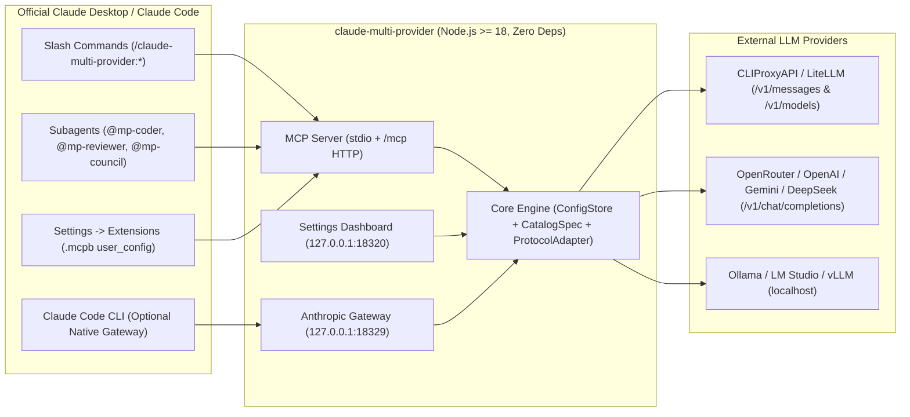

# Architecture & Domain Specification (`claude-multi-provider`)

## 1. Purpose & Problem Statement
Official Claude Desktop and Claude Code users often want to call external or self-hosted LLM providers—such as **CLIProxyAPI (CPA)**, **OpenRouter**, **OpenAI**, **Google Gemini**, **DeepSeek**, **Groq**, **LiteLLM**, **Ollama**, or **LM Studio**—for specialized coding tasks, second-opinion code reviews, multi-model panels, or cost-effective bulk subagent work, **without modifying or patching official Claude binaries**.

`claude-multi-provider` packages a complete multi-provider LLM engine, interactive **LLM Providers & Model Catalog** settings dashboard, MCP server, slash commands, and subagents into a standard, 100% compliant **Claude Plugin + Desktop Extension (`.mcpb`)**.

---

## 2. Domain Glossary (Ubiquitous Language)

| Term | Definition |
| :--- | :--- |
| **Provider** | An upstream LLM API endpoint (`id`, `name`, `baseUrl`, `apiKey`, `protocol`: `auto` \| `openai` \| `anthropic`, `enabled`). |
| **Catalog Model** | A model discovered from a Provider via `GET /v1/models` (+ optional `GET /v1beta/models`), enriched with `contextWindow`, `autoCompactLimit` (`90%` default), `maxOutputTokens`, and `effortLevels`. |
| **Custom Model** | A user-enabled model entry in the active catalog with display `name`, `providerId`, `contextWindow`, `autoCompactLimit`, `effortLevels`, `defaultEffort`, and Claude CLI `behavesAs` profile. |
| **Protocol Adapter** | Bidirectional translator converting Anthropic Messages (`/v1/messages`, including tool definitions and SSE streams) to/from OpenAI Chat Completions (`/v1/chat/completions`), or normalizing native Anthropic-compatible upstreams. |
| **MCP Bridge** | JSON-RPC 2.0 Model Context Protocol server (`stdio` + Streamable HTTP `/mcp`) exposing `mp_chat`, `mp_compare_models`, `mp_list_models`, `mp_fetch_catalog`, `mp_configure_provider`, `mp_open_settings`, and `mp_gateway_status`. |
| **Settings Dashboard** | Local loopback Web UI (`http://127.0.0.1:18320`) protected by `HttpOnly; SameSite=Strict` + `X-CMP-Token` auth, providing the **LLM Providers**, **Model Catalog**, and **Claude Integration & Logs** tabs. |
| **Local Gateway** | Optional loopback Anthropic-compatible HTTP/SSE proxy (`http://127.0.0.1:18329`) for Claude Code CLI / IDE users who opt in to native `ANTHROPIC_BASE_URL` + `modelPicker.options` routing. |

---

## 3. System Topology & Deep Modules

### Module Boundaries
1. `src/core/security.mjs` — Cryptographic session tokens, `SameSite=Strict` cookie issuance, `X-CMP-Token` verification, origin checks, and API key masking (`sk-••••1234`).
2. `src/core/catalog-spec.mjs` — Context window & auto-compact inference (`90%` default), reasoning effort detection, URL normalization (avoids `/v1/v1` duplication), and `/v1/models` + `/v1beta/models` merger.
3. `src/core/config-store.mjs` — Atomic `0o600` persistence at `~/.claude/multi-provider.json` (or `CMP_CONFIG_PATH`), `.mcpb` env var seeding (`CMP_PROVIDER_*`), and key-preserving updates.
4. `src/core/protocol-adapter.mjs` — Anthropic Messages $\leftrightarrow$ OpenAI Chat Completions request/response/SSE stream translator + native Anthropic upstream normalizer + `auto` protocol fallback.
5. `src/core/cli-sync.mjs` — Opt-in `~/.claude/settings.json` `modelPicker` + `autoCompactWindow` synchronizer and `claude_desktop_config.json` backup-safe installer.
6. `src/core/gateway-server.mjs` — Loopback HTTP/SSE Anthropic-compatible `/v1/messages` & `/v1/models` & `/health` server.
7. `src/core/dashboard-server.mjs` + `src/ui/dashboard-html.mjs` — Token-guarded REST API + `/mcp` Streamable HTTP endpoint + responsive (`1440px` & `375px`) 3-tab Settings Web UI.
8. `src/mcp-server.mjs` — Official MCP `stdio` server entry point + reusable JSON-RPC dispatcher.
9. `bin/cli.mjs` — Unified CLI (`mcp`, `dashboard`, `gateway`, `install-desktop`, `sync-cli`, `pack-mcpb`, `status`).
