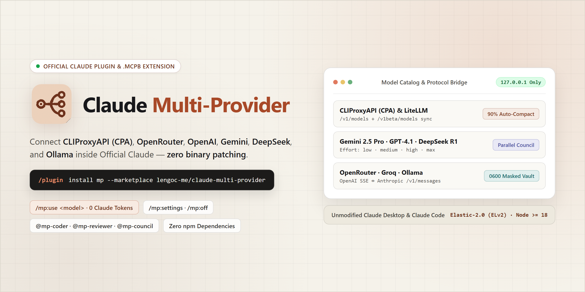
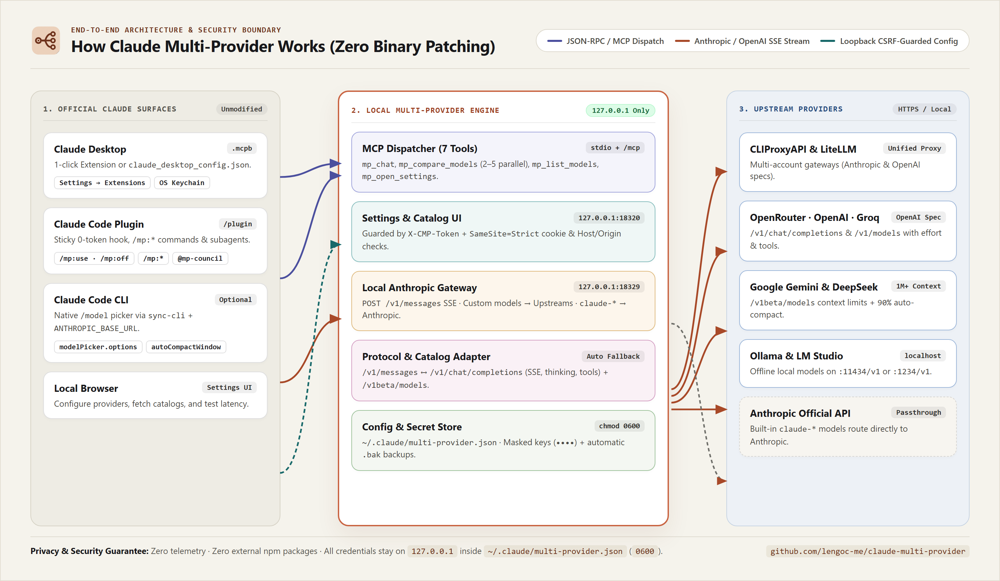
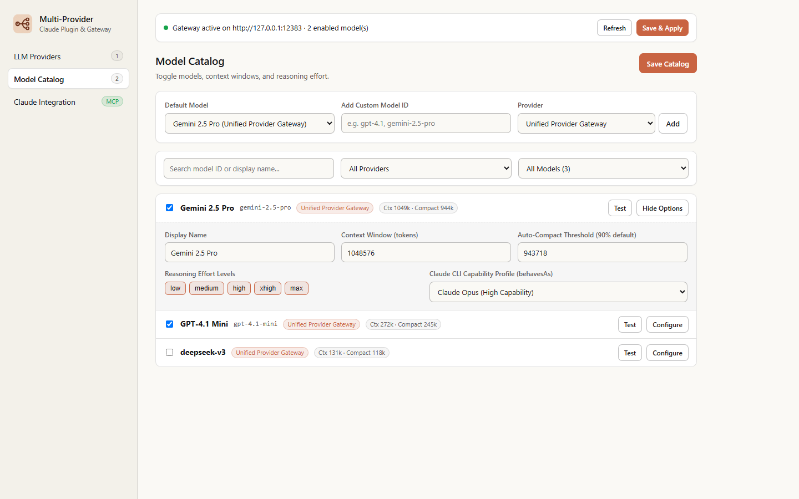
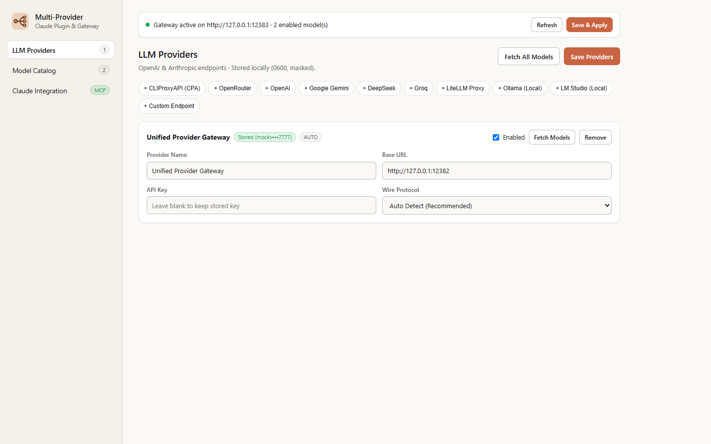
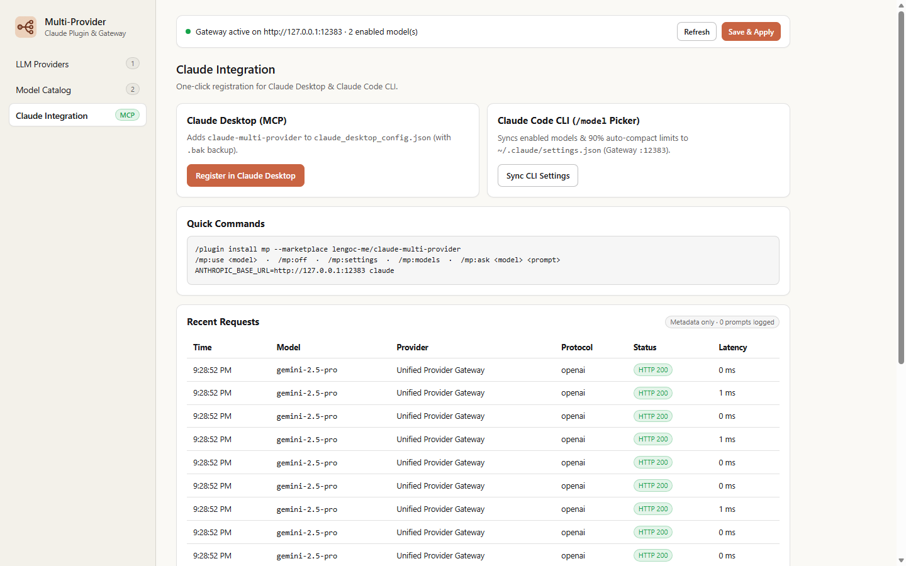
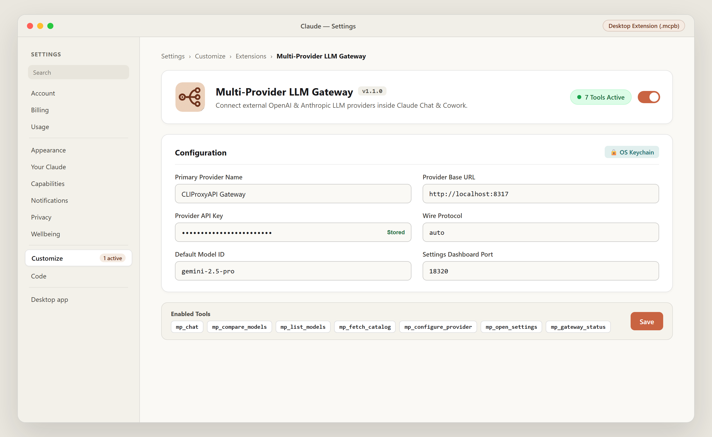
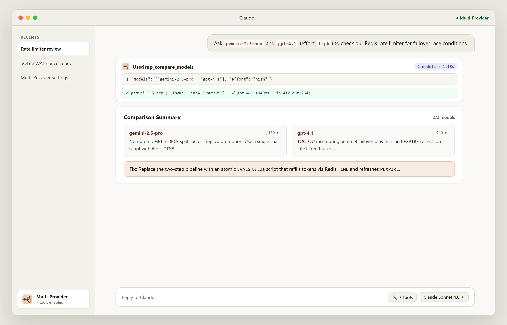
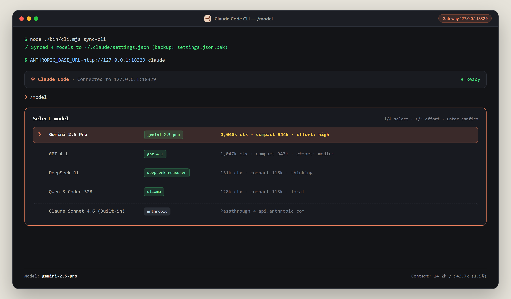
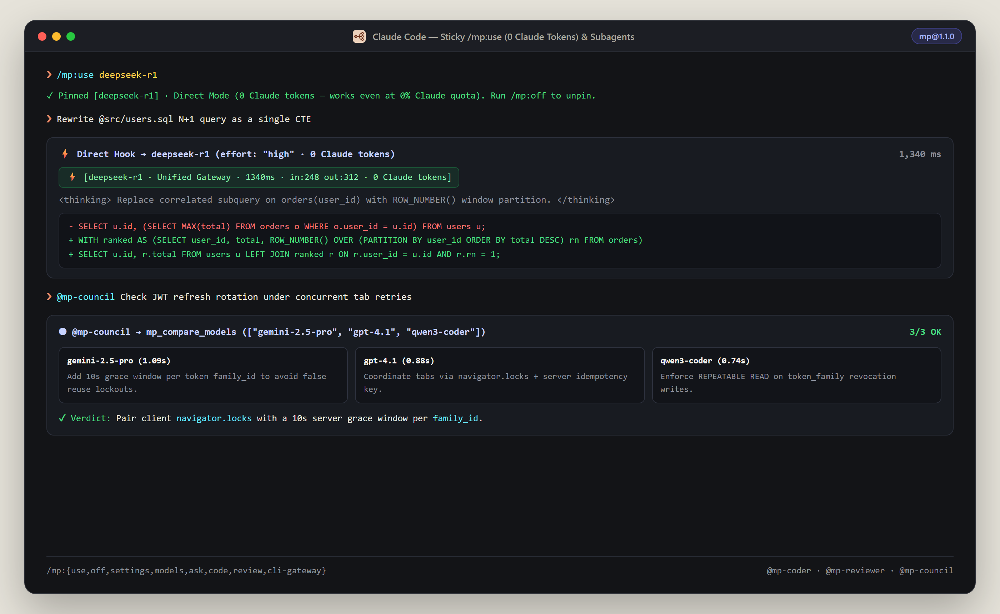

<p align="center">
  
</p>

<h1 align="center">Claude Multi-Provider (<code>claude-multi-provider</code>)</h1>

<p align="center">
  <a href="https://github.com/lengoc-me/claude-multi-provider/releases"></a>
  <a href="./LICENSE"></a>
  = 18" />
  
</p>

<p align="center">
  Use external OpenAI-compatible and Anthropic-compatible LLM providers—including <strong>CLIProxyAPI (CPA)</strong>, <strong>OpenRouter</strong>, <strong>OpenAI</strong>, <strong>Google Gemini</strong>, <strong>DeepSeek</strong>, <strong>Groq</strong>, <strong>LiteLLM</strong>, <strong>Ollama</strong>, and <strong>LM Studio</strong>—directly inside <strong>Official Claude Desktop</strong> and <strong>Claude Code</strong>, <strong>100% without binary patching</strong>.
</p>

---

## How It Works (Architecture & Mechanism)

**Claude Multi-Provider runs entirely on `127.0.0.1` as an official Claude Plugin & `.mcpb` Desktop Extension, bridging Claude's native surfaces to any upstream LLM API.**



1. **Official Claude Surfaces (Left)**: Unmodified **Claude Desktop** (via `.mcpb` Extension, `claude_desktop_config.json`, or **Code / Cowork** tabs) and **Claude Code** (via `/plugin` slash commands `/mp:*`, sticky `UserPromptSubmit` hook `/mp:use <model>`, specialist subagents `@mp-coder` / `@mp-reviewer` / `@mp-council`, or optional CLI `ANTHROPIC_BASE_URL` mode) dispatch requests locally.
2. **Local Multi-Provider Engine (Center — `127.0.0.1`)**:
   - **MCP Dispatcher (`stdio` + `/mcp`)**: Exposes 7 MCP tools including `mp_chat` and `mp_compare_models` (2–5 parallel models).
   - **Settings & Model Catalog Dashboard (`127.0.0.1:18320`)**: Token- & CSRF-guarded Web UI for managing providers, fetching `/v1/models` + `/v1beta/models`, and tuning context windows, `90%` auto-compact limits, and reasoning effort levels.
   - **Local Anthropic Gateway (`127.0.0.1:18329`) & Universal Protocol Adapter**: Translates Anthropic `/v1/messages` ↔ OpenAI `/v1/chat/completions` (JSON, SSE streaming, thinking blocks, and tool calls) with automatic `404`/`405` fallback while passing native `claude-*` models straight to `api.anthropic.com`.
   - **Atomic Secret Store (`0600`)**: Persists configuration in `~/.claude/multi-provider.json` and masks API keys (`••••`) across every HTTP, DOM, log, and MCP surface.
3. **Upstream Providers (Right)**: Connects simultaneously to **CLIProxyAPI (CPA)**, **LiteLLM**, **OpenRouter**, **OpenAI**, **Google Gemini**, **DeepSeek**, **Groq**, and local **Ollama / LM Studio** servers.

---

## Built-in Settings & Model Catalog UI

Launch the local dashboard anytime with `/mp:settings` inside Claude or `node ./bin/cli.mjs dashboard` in your terminal:







---

## Visual Walkthrough: Desktop & CLI Experience

*Illustrative walkthrough previews of how `claude-multi-provider` integrates inside Claude Desktop and Claude Code CLI:*

### 1. Claude Desktop — `.mcpb` Extension Settings (`Settings → Customize → Extensions`)
Installing `claude-multi-provider.mcpb` (via top menu **Extensions → Install Extension…** or double-clicking the `.mcpb` bundle) displays the extension icon and initial configuration form inside **Settings → Customize** (while the full multi-provider & catalog UI opens anytime at `http://127.0.0.1:18320` via `/mp:settings`):



### 2. Claude Desktop — Querying & Comparing External Models
Call a single model (`mp_chat`) or compare 2–5 models in parallel (`mp_compare_models`) inside **Chat** or **Cowork**:



### 3. Claude Code CLI — `/model` Picker via Local Gateway
Run `node ./bin/cli.mjs sync-cli` to sync enabled models (`modelPicker.options` + `90%` `autoCompactWindow`) for `ANTHROPIC_BASE_URL=http://127.0.0.1:18329 claude`:



### 4. Claude Code & Desktop `Code` Tab — Sticky `/mp:use` (`0` Claude Tokens) & Subagents
Pin an external model once with `/mp:use <model>` (`0` Claude tokens — works even when Claude quota is exhausted!), use `/mp:*` commands, or delegate to `@mp-coder` / `@mp-reviewer` / `@mp-council` subagents without changing `ANTHROPIC_BASE_URL`:



---

## Key Features

- **100% Official Claude Compatible**: Works with unmodified Microsoft Store / macOS / Windows / Linux Claude Desktop and Claude Code CLI.
- **Zero External Dependencies**: Pure Node.js (`>= 18.0.0`) standard library runtime—no `npm install` compilation issues or supply-chain bloat.
- **Built-in Settings & Model Catalog UI (`127.0.0.1:18320`)**:
  - Add unlimited providers using 1-click presets (**CLIProxyAPI**, **OpenRouter**, **OpenAI**, **Google Gemini**, **DeepSeek**, **Groq**, **LiteLLM**, **Ollama**, **LM Studio**, or custom URLs).
  - Fetch `/v1/models` + `/v1beta/models` to auto-populate authoritative **Context Windows** and **90% Auto-Compact Thresholds**.
  - Configure reasoning effort levels (`low`, `medium`, `high`, `xhigh`, `max`) and test models live with latency metrics.
- **Universal Wire Protocol Translation**:
  - Automatically bridges Anthropic `/v1/messages` ↔ OpenAI `/v1/chat/completions` (including SSE streaming, thinking blocks, and tool calls) or routes directly to Anthropic-compatible proxies (`protocol: "auto" | "openai" | "anthropic"`).
- **Hardened Local Security**:
  - Strict loopback (`127.0.0.1`) binding, `HttpOnly; SameSite=Strict` + `X-CMP-Token` CSRF protection, DNS-rebinding Host/Origin guards, `0600` config file permissions, and automatic API key masking (`sk-••••abcd`) across all HTTP, MCP, and log surfaces.

---

## Installation Guide

> **Prerequisite**: [Node.js 18+](https://nodejs.org/) installed on your machine.

### Option 1: Install as an Official Claude Plugin (Claude Code & Claude Desktop `Code` / `Cowork` Tabs)

Run this single command inside **Claude Code** or the **Code** tab in **Claude Desktop** (Claude Code `2.1.275+`):

```text
/plugin install mp --marketplace lengoc-me/claude-multi-provider
```

*(Or in two steps on older versions: `/plugin marketplace add lengoc-me/claude-multi-provider` followed by `/plugin install mp`.)*

Then open the **LLM Providers & Model Catalog** configuration UI right from chat:

```text
/mp:settings
```

---

### Option 2: Install into Official Claude Desktop (Chat & Cowork Tabs)

You can connect `claude-multi-provider` to Official Claude Desktop in two ways:

#### 2A. One-Click `.mcpb` Desktop Extension (Native Settings Form in Claude Desktop)
1. Download `claude-multi-provider.mcpb` from the [GitHub Releases](https://github.com/lengoc-me/claude-multi-provider/releases) page (or build it locally with `npm run pack:mcpb`).
2. In **Claude Desktop**, open **Extensions → Install Extension…** from the menu bar (or double-click `claude-multi-provider.mcpb`).
3. Fill in your initial **Provider Base URL** and **API Key** directly inside **Settings → Customize** (stored in your OS keychain), or open `http://127.0.0.1:18320` (`/mp:settings` or ask Claude to *"open Multi-Provider settings"*) for full multi-provider & Model Catalog configuration!
*(Note: Unmodified Claude Desktop locks its top-level left Settings sidebar tabs; `.mcpb` extensions appear inside **Settings → Customize**, while `claude_desktop_config.json` MCP servers appear inside **Settings → Desktop app → Developer**.)*

#### 2B. Automatic `claude_desktop_config.json` Registration via CLI
Clone the repository and run the built-in installer (automatically creates a `.bak` backup of any existing config):

```bash
git clone https://github.com/lengoc-me/claude-multi-provider.git
cd claude-multi-provider
node ./bin/cli.mjs install-desktop
```

Restart Claude Desktop after registering.

---

## Configuring Providers & Models

Launch the local **LLM Providers & Model Catalog** Web Dashboard at any time:

- **Inside Claude**: Run `/mp:settings` (or ask Claude to call `mp_open_settings`).
- **From Terminal**:
  ```bash
  node ./bin/cli.mjs dashboard
  ```

### Quick Setup Steps in the Dashboard
1. **LLM Providers Tab**:
   - Click a preset chip (e.g., `+ CLIProxyAPI (CPA)`, `+ OpenRouter`, `+ OpenAI`, `+ Google Gemini`, `+ DeepSeek`, `+ Ollama (Local)`).
   - Enter your **Base URL** and **API Key**, then click **Save Providers**.
   - Click **Fetch Models** to query `/v1/models` (and `/v1beta/models` when available) and automatically import context window & `90%` auto-compact specs.
2. **Model Catalog Tab**:
   - Check the models you want to enable (or add any custom model ID manually).
   - Optionally click **Configure** on any model to customize its Display Name, Context Window, Auto-Compact Limit, and Reasoning Effort chips, or click **Test** to verify live connectivity.
   - Select your **Default External Model** and click **Save Catalog**.

Configuration is stored locally at `~/.claude/multi-provider.json` (`0600` permissions).

---

## Usage Inside Claude

### 1. Sticky Session Pinning (`/mp:use` — Zero Claude Tokens)

Inside **Claude Desktop (`Code` / `Cowork` tabs)** or **Claude Code CLI**, pin any external model once and chat normally without repeating prefixes:

```text
/mp:use gemini-2.5-pro
```

- **Direct Mode (Default — `0` Claude Tokens)**: Intercepted locally via Claude's official `UserPromptSubmit` hook *before* calling `api.anthropic.com`. Consumes **zero Claude tokens**, works **even when your Claude account quota is 100% exhausted**, remembers multi-turn session context, and automatically attaches local `@path/to/file` mentions inside your workspace.
- **Agentic Mode (`--agentic`)**: Run `/mp:use gemini-2.5-pro --agentic` when you want Claude to keep its native `Read`/`Edit`/`Bash` workspace tools active while delegating heavy reasoning to the external model via `mp_chat`.
- **Switch Back Anytime**: Run `/mp:off` (`0` Claude tokens) so your very next message uses the native Claude model selected in the bottom dropdown picker.

### 2. Slash Commands (`/mp:*`)

| Command | Description |
| :--- | :--- |
| `/mp:use [model] [--agentic]` | Pin an external model for all subsequent messages in this session (`0` Claude tokens in default Direct mode; `--effort high` optional). |
| `/mp:off` | Unpin the active external model and return immediately to the bottom Claude model picker (`0` Claude tokens). |
| `/mp:claude <prompt>` | Send a single one-off turn to the native Claude model without clearing an active `/mp:use` pin. |
| `/mp:settings` | Launch the local **LLM Providers & Model Catalog** Web UI (`127.0.0.1:18320`) and show status. |
| `/mp:models [refresh]` | View configured providers, enabled models, context limits, or refresh from `/v1/models`. |
| `/mp:ask <model> <prompt>` | Ask a specific external model a one-shot question and return its response + latency/token stats. |
| `/mp:code <model> <task>` | Delegate a coding, refactoring, or debugging slice with workspace context to an external model. |
| `/mp:review [m1,m2]` | Run an independent cross-model code review on `git diff` using 1 or multiple external models. |
| `/mp:cli-gateway [sync]` | Start/inspect the local Anthropic Gateway (`127.0.0.1:18329`) for standalone Claude Code CLI sessions. |

### 3. Subagents (`@`)

- **`@mp-coder`** — Delegates implementation & debugging reasoning to configured external models while reading/editing workspace files.
- **`@mp-reviewer`** — Runs independent cross-family Spec, Security, and Bug audits to eliminate single-model blind spots.
- **`@mp-council`** — Queries 2–5 external models **in parallel** via `mp_compare_models` and synthesizes consensus + trade-offs.

### 4. MCP Tools Available in Chat & Cowork

| Tool | Purpose |
| :--- | :--- |
| `mp_list_models` | List configured providers (with masked keys) and enabled/cached models. |
| `mp_chat` | Send single-turn or multi-turn conversations (`system`, `effort`, `temperature`, `max_tokens`) to any external model. |
| `mp_compare_models` | Query 2–5 external models concurrently and compare outputs side-by-side. |
| `mp_fetch_catalog` | Refresh `/v1/models` and `/v1beta/models` metadata from providers. |
| `mp_configure_provider` | Add/update provider endpoints or enable models programmatically. |
| `mp_open_settings` | Start and open the local Settings & Model Catalog Web Dashboard. |
| `mp_gateway_status` | Manage the local Anthropic-compatible Gateway (`127.0.0.1:18329`) and optional CLI sync. |

---

## Bonus: Native Primary-Model Mode for Claude Code CLI

If you use **Claude Code CLI** in your terminal or IDE and want to select external models directly from Claude Code's native `/model` picker as the **primary session model**:

1. Sync your enabled custom models into `~/.claude/settings.json` (`modelPicker.options` + `autoCompactWindow` — creates an automatic `.bak` backup first):
   ```bash
   node ./bin/cli.mjs sync-cli
   ```
2. Start the local Anthropic-compatible Gateway in the background (or via `node ./bin/cli.mjs serve`):
   ```bash
   node ./bin/cli.mjs gateway
   ```
3. Launch Claude Code CLI pointed at the local gateway:
   ```bash
   ANTHROPIC_BASE_URL=http://127.0.0.1:18329 claude
   ```
   - Custom external models route seamlessly to their configured upstream provider (translating OpenAI `/v1/chat/completions` SSE streams to Anthropic `/v1/messages` SSE streams on the fly).
   - Built-in `claude-*` models automatically pass through to `https://api.anthropic.com`.

---

## CLI Reference

```bash
node ./bin/cli.mjs help             # Show all CLI commands and flags
node ./bin/cli.mjs dashboard        # Start Settings & Model Catalog Web UI (127.0.0.1:18320)
node ./bin/cli.mjs gateway          # Start Anthropic-compatible Gateway (127.0.0.1:18329)
node ./bin/cli.mjs serve            # Start both Dashboard and Gateway together
node ./bin/cli.mjs install-desktop  # Register MCP server in claude_desktop_config.json
node ./bin/cli.mjs sync-cli         # Opt-in sync to ~/.claude/settings.json modelPicker
node ./bin/cli.mjs status           # Print redacted configuration status JSON
npm run pack:mcpb                   # Build dist/claude-multi-provider.mcpb bundle
npm run assets:generate             # Deterministically regenerate icon, cover banner & architecture diagram
npm test                            # Run unit + E2E test suite
npm run security:audit              # Verify zero secrets or private endpoints in repo & git history
```

---

## Security & Privacy Architecture

- **Local-Only Execution**: All configuration (`~/.claude/multi-provider.json`) and API keys stay strictly on your machine. No telemetry is ever sent to third parties.
- **Secret Redaction**: Plaintext API keys are never returned by `/api/state`, `/health`, MCP tools, or request logs.
- **Anti-CSRF & Loopback Protection**: The local Settings Dashboard binds strictly to `127.0.0.1`, enforces cryptographic `X-CMP-Token` + `HttpOnly; SameSite=Strict` cookies, and blocks cross-origin requests and non-loopback `Host` headers (`401`/`403`).

---

## License

Copyright © 2026 [lengoc-me](https://github.com/lengoc-me).

Licensed under the [Elastic License 2.0 (ELv2)](./LICENSE). Free to use, copy, modify, and distribute for local or internal use; you may not provide the software to third parties as a hosted or managed service.
